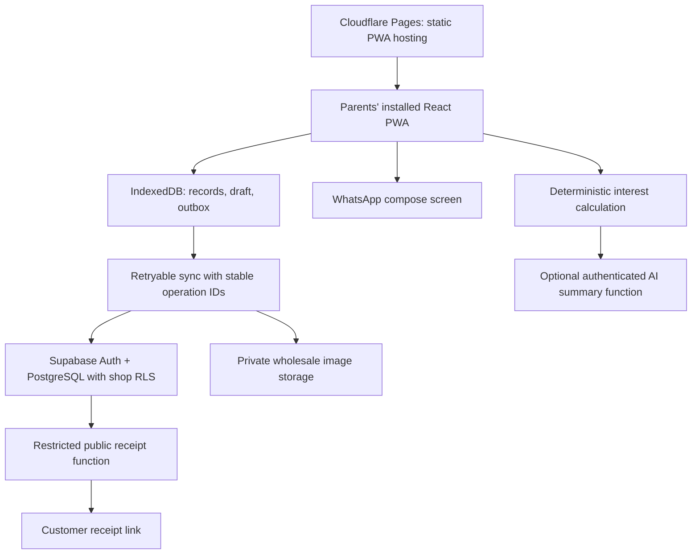

# Munsi Kirana Store — project intention, product design, and recommendations

Prepared 1 November 2026. This is a product blueprint and build brief, not a claim that the app has already been built or deployed.

The interactive mobile layout reference is `output/munsi-ui-layout.html`. It demonstrates Home, Billing, Inventory, Khata, Byaj, Receipt, More, and Daily overview using sample data. Use it to assess the visual hierarchy; it is not the real shop application.

## 1. The reason to build this

Munsi Kirana Store should help your parents run the counter confidently: find the right rate when one parent is away, bill without mental arithmetic, remember who owes what, record repayments, and explain byaj consistently. Your Dadaji's identity should make it feel like your family's shop, rather than a generic business dashboard.

The final goal is an installable, Hindi-friendly app that both parents can trust on an ordinary Android phone, including during weak internet. Success means fewer errors and less effort in a real sale. More features are useful only when they support that goal.

Default assumptions: one shop, two Android phones, INR, Indian mobile numbers, Asia/Kolkata business dates, Hindi-first labels with familiar English product names, and no recurring paid services. These are editable settings, not facts supplied about your family. No personal photograph, credentials, actual stock list, or customer data has been provided in this workspace.

## 2. What should improve on the original proposal

| Original direction | Recommended decision | Why it matters in your shop |
|---|---|---|
| A purple app with four modules | A consistent counter workflow: Home, Bill, Khata, More | Your parents learn one navigation pattern; rates and billing stay easy to reach. |
| LocalStorage fallback | IndexedDB for business records and offline operations; LocalStorage for preferences only | Bills, receipt images, and queued changes need more dependable storage and transactions. Browser storage still needs backups. |
| Cloud database without an access model | Supabase Auth, shop membership, row-level security, private photo storage | A public frontend key must not make customer debts and purchase costs public. |
| Public bill by database ID | A separate, revocable receipt-sharing token and a deliberately limited public response | Customers should receive their bill, without access to other bills or shop costs. |
| Save every new rate as inventory | Learn genuinely new items and explicitly identified packs; treat selected-item rate edits as bill-only overrides | A discounted sale of Sugar at ₹59 must not replace its ₹60 default or create endless duplicate SKUs. |
| Credit entry is an editable amount due | Customer accounts with charges, repayments, allocations, and reversal records | Partial repayments and corrections must remain explainable. |
| An AI explanation is required | Exact local calculations and bilingual templates first; optional server-side AI paraphrasing | The shop must work without an API key, an available free model, or internet. |
| Apriori from day one | Rank actual pair association rules after sufficient sales; start with recent and popular products | A brand-new shop database has no evidence for genuine “frequently bought together” claims. |
| Every photo must be under 100 KB | Aim near 100 KB when readable; permit a larger compressed image within a configured cap | An unreadable wholesale receipt saves storage but loses the evidence you needed. |
| PWA means everything works offline | Cache the app shell and save business operations locally; explicitly show what awaits internet | Voice services, shared links, remote images, AI, and cross-phone sync can require connectivity. |
| Vercel Hobby is the automatic free host | Prefer Cloudflare Pages for this business application, subject to checking current terms; use Vercel only with an eligible plan | Vercel Hobby has historically restricted use to personal, non-commercial projects. A kirana shop is commercial. |

## 3. Keep the useful additions focused

Include in the first complete release:

- **Cash, UPI, udhaar, and split payments.** Record what was received and what remains due. Record a UPI payment as owner-confirmed; opening a UPI app is not proof of payment.
- **Repayments and customer statements.** Log ₹200 received against a ₹750 balance and show ₹550 remaining, with dates and history.
- **Saved billing drafts.** A call, accidental Back press, or app restart must not lose the basket.
- **Bill history and corrections.** Search past receipts; void or adjust with an audit trail. Never silently rewrite a completed bill.
- **Daily overview.** Separate sales, cash received, UPI received, newly given credit, and old credit collected. These answer different questions.
- **CSV import and reliable backup/restore.** Include a sample inventory import, validation preview, duplicate handling, encrypted backup export, and a tested restore path.
- **Visible save and sync state.** “Saved on this phone,” “Synced,” and “Needs attention” must mean different things.
- **Hindi/English toggle, readable amounts, and consistent controls.** Add manual searchable Hindi aliases instead of depending on AI translation.
- **Owner setup.** Upload Dadaji's photograph, enter shop details, set rates, connect cloud storage, invite the second phone, and practise with clearly marked sample data.

Offer stock tracking only as a separate opt-in after the financial flows are reliable. Use stock movements and opening stock when enabled; do not show misleading zero-stock warnings for an uncounted shop.

Defer supplier accounts, purchase-order automation, expiry tracking, GST filing, full accounting, automatic WhatsApp messages, automatic UPI verification, OCR, barcode hardware, and an AI chatbot. They introduce distinct operational or service dependencies. This first release can export records for an accountant and produce a clearly labelled regular sales receipt; it must not claim GST tax-invoice compliance without a separate implementation.

## 4. The visual direction

Use the warmth of a family shop with PhonePe-like familiarity. Use your own layout and assets; do not copy another app's logo or trade dress.

| Element | Direction |
|---|---|
| Main purple | `#5F259F`; darkest headings `#29163D` |
| Background | Warm off-white `#F8F7FB`; white cards; restrained pale-purple sections |
| Supporting colors | Green for received/saved; amber for pending; red for errors/overdue. Always include text or an icon. |
| Typography | Self-hosted Noto Sans Devanagari plus a readable Latin/system font; tabular numerals for money |
| Type sizes | Body 18px; labels normally 16px or more; section titles 22–26px; important totals 32–40px |
| Tap targets | Main controls at least 56px high; secondary icon hit areas at least 48×48px, even when the drawn icon is small |
| Shape and spacing | 16px card corners, 16px page gutter, 8px spacing scale, clear boundaries, restrained shadows |
| Phone layout | Designed at 360–430px wide; never a desktop table squeezed into a phone |
| Larger screens | A centered, wider workspace with the same navigation and familiar control order |
| Motion | Short, subtle feedback; a recording indicator only while the microphone is active; respect reduced-motion settings |

Keep practical labels visible: `बिल बनाएँ / New bill`, `भाव पूछें / Check rate`, `उधार खाता / Khata`, `भुगतान मिला / Payment received`. Avoid paragraphs of bilingual text on every button. The chosen language gets the main label; the second language appears only where it helps recognition.

The small cost `(i)` button is an intentional reveal control, not a security boundary. Cost information still requires authorized shop access. A local privacy lock can reduce accidental viewing, but it is not a replacement for authentication.

## 5. Complete screen layout

### Home — a calm counter starting point

```text
┌────────────────────────────────────┐
│ [Dadaji] Munsi Kirana Store   हिन्दी │
│          परिवार की दुकान            │
├────────────────────────────────────┤
│ ✓ Synced • last saved 10:42         │
│ [आइटम का नाम बोलें या लिखें] [🎙]    │
│ Search results appear here         │
├─────────────────┬──────────────────┤
│  New bill       │  Add/update item  │
│  बिल बनाएँ      │  सामान जोड़ें     │
├─────────────────┼──────────────────┤
│  Byaj           │  Credit ledger   │
│  ब्याज          │  उधार खाता        │
├────────────────────────────────────┤
│ Today: sales | received | new due  │
│ [Resume saved bill — if present]   │
│ Recent bills • View all            │
├────────────────────────────────────┤
│  Home       Bill      Khata   More  │
└────────────────────────────────────┘
```

Keep the four actions visible above long history. Search results show item name, pack/unit, selling price, and the cost-info button. Never show purchase cost on the result card itself. Display example phrases until the user searches, including `चीनी`, `SU`, and `मूंगफली का तेल`.

### New bill — one task at a time

Order: page title → Create bill / Add items switch → optional customer selector → item search → selected item's rate/quantity/unit controls → Add item → basket rows → suggestion chips → payment choice → sticky total and Save bill.

```text
┌────────────────────────────────────┐
│ ← New bill       [Saved draft]      │
│ [Create bill] [Add/update items]    │
│ Customer (optional)          [+]   │
│ [Search / speak item]        [🎙]   │
│ Sugar • per kg                 (i)│
│ Rate ₹ [59.50]   Qty [2.5] [kg ▾] │
│                     Total ₹148.75 │
│ [           Add item           ]  │
│ Basket                             │
│ Sugar  2.5 kg × ₹59.50     ₹148.75 │
│ [Edit] [Remove]                     │
│ Often bought together: [Tea +]     │
│ Payment: [Cash] [UPI] [Udhaar]     │
├────────────────────────────────────┤
│ Total ₹148.75      [Save bill]     │
└────────────────────────────────────┘
```

Add and Save are different actions. Save produces a receipt once and prevents repeat taps. An incomplete active row prompts Add item or Discard; it must not disappear silently. A known item's rate override displays “This bill only.” Explicit new-pack creation shows the proposed name, unit, and variant before learning it on successful save.

After saving: large success check, receipt number and amount, itemized receipt, payment breakdown, and `Send on WhatsApp`, `Print / Save PDF`, `New bill`. Sharing opens a prepared WhatsApp message; the parent still taps Send there. Offline sharing includes receipt text and does not claim to have a working online link.

### Inventory — fast maintenance, less clutter

Order: search → Add item button → multi-select action → cards with name, variant, unit, selling rate → edit form → private purchase-cost section → wholesale photo viewer.

The item form includes English/display name, Hindi name and aliases, stable pack/variant, selling unit, selling price, nullable cost price, and optional barcode field only if barcode support is implemented. Use kg/g and litre/ml conversion where appropriate; a piece pack cannot be sold as kg accidentally. A bulk image toolbar reads “Attach one bill to 4 items.” Show upload/compression progress and a readable preview before saving.

### Khata — outstanding amount with a trustworthy history

Order: total outstanding → Search customer → two clear actions `Add udhaar` and `Payment received` → customer cards with balance and last transaction → account detail.

The account detail shows a running statement with charges, repayments, corrections, bill links, and optional due dates. Include `Send reminder` and `Share statement`. A repayment is a new entry, not editing or deleting the original debt. Phone numbers are optional for keeping a ledger and required only when sharing to a specific WhatsApp number. Highlight overdue only when there is a real due date.

### Byaj — clear assumptions and readable steps

Order: “Monthly rate; compound yearly” method label → loan-entry cards → Add another entry → Calculate → individual result cards → grand total → bilingual explanation → Print/share calculation.

Each input card contains Principal, Monthly %, Start date typed as DD-MM-YYYY, and Today / Custom end date. Keep the numeric keypad and typed date mask. Each result shows exact calendar years/months/days separately from the 30-day residual-interest convention. Explain that interest is added at each completed year, then charged proportionally for the remaining period. Do not put loan totals into customer shopping khata automatically.

### Daily overview and bill history

Reach through Home's summary or More. Default to today, with date filters. Show sales after adjustments, collections by method, credit issued, and repayments received, each with a definition. Display last-sync time and warn gently if another device's pending sales may be missing. Show estimated margin only for lines with known cost and explicitly label partial coverage; sales minus collections is not profit.

### More and setup

Use a simple list: Inventory, Byaj, Bill history, Daily overview, Language & text size, Shop profile, Backup & restore, Sync & devices, Help. Administrator-only setup contains integrations and family access. Never display an API-key form to the parents during normal billing.

Setup has a practise path and a real-shop path. Sample data is clearly separated. Start with a usable family monogram if no photo is supplied. Later, crop the supplied Dadaji photograph and generate real 192px/512px app icons as part of the asset build; uploading a profile picture alone does not guarantee that an already-installed PWA icon changes immediately.

## 6. Recommended technical shape



Use React, TypeScript, Vite, Tailwind, React Router, Lucide, Dexie/IndexedDB, a decimal arithmetic library, schema validation, and vite-plugin-pwa. Supabase supplies synchronization, authentication, database transactions, private image storage, and small server functions. Keep local and cloud repositories behind one domain interface.

Use stable IDs and an outbox to prevent duplicate bills when the network fails after the server commits. Saved financial entries use append-only adjustments. Inventory edits use version checks rather than silently overwriting the other parent's changes. Surface unresolved conflicts in one understandable place.

## 7. Free services and their limits

These are recommendations, not a guarantee of permanent free service. Live verification was unavailable from this workspace on 1 November 2026. Antigravity should verify the current official limits and terms, record the date, and configure no paid fallback before deployment.

| Need | Recommended source | Practical constraint |
|---|---|---|
| App hosting | [Cloudflare Pages](https://pages.cloudflare.com/) and [limits](https://developers.cloudflare.com/pages/platform/limits/) | Use the provider subdomain to avoid buying a domain. Confirm current commercial-use terms and free limits. Static hosting and server-function quotas are separate. |
| Cloud records, login, photos | [Supabase pricing](https://supabase.com/pricing) and [RLS guide](https://supabase.com/docs/guides/database/postgres/row-level-security) | Historically the Free plan has listed 500 MB database and 1 GB file storage. Check current limits, egress, inactivity pausing, project limits, function quotas, and recovery/backup availability. Do not depend on free managed backups. |
| Alternative hosting | [Vercel Hobby terms](https://vercel.com/docs/plans/hobby) | Historically personal/non-commercial; do not assume a shop qualifies. |
| Offline installation | [Vite PWA](https://vite-pwa-org.netlify.app/) | HTTPS is needed in production. Installation and background execution vary by browser and operating system. |
| Local database | [Dexie](https://dexie.org/) and [browser storage behavior](https://developer.mozilla.org/en-US/docs/Web/API/Storage_API/Storage_quotas_and_eviction_criteria) | Browser data may be cleared or evicted. Request persistence where supported and provide independent exports. |
| Voice input | [Web Speech API](https://developer.mozilla.org/en-US/docs/Web/API/Web_Speech_API) | Browser support is uneven; some implementations use online recognition services. Hindi/English recognition is best effort, with typing always available. |
| Optional AI | [OpenRouter model catalog](https://openrouter.ai/models) and [limits](https://openrouter.ai/docs/api-reference/limits) | Free models change, are rate-limited, and may be unavailable. Verify the current API documentation path and terms. No paid model fallback. |
| Messaging | [WhatsApp click-to-chat](https://faq.whatsapp.com/5913398998672934) | Opens a pre-filled message; it does not send automatically or prove delivery. No WhatsApp Business API is needed for this design. |
| Fonts and icons | [Noto fonts](https://fonts.google.com/noto) and [Lucide](https://lucide.dev/) | Self-host fonts, retain applicable licenses, and avoid external font calls on sensitive receipt pages. |

The ₹0 target is realistic for a small shop within free quotas, using existing phones/data and a provider subdomain. It is not a promise of unlimited storage, guaranteed uptime, free future plan changes, or free AI usage forever. Monthly cleanup should never delete financial records to meet a quota; warn, export, and archive deliberately instead.

## 8. What access Antigravity should use

Existing personal access should make setup easier, not enlarge this project's scope. Antigravity may inspect this workspace and explicitly identified shop assets and use integrations authorized for this project. It should not search unrelated personal files, mine contacts for customers, copy credentials into source code, use your Dadaji's photograph with an external image service without a reason and authorization, or send real WhatsApp messages while testing.

Use synthetic customers for tests. Keep service-role and AI keys only in server secrets; Vite-prefixed values are public in the browser bundle. A Supabase publishable/anon key is suitable for the frontend only with correct authentication and RLS.

## 9. Definition of a successful first release

1. Your mother finds the correct saved rate through Hindi aliases or typing without relying on your father's presence.
2. A familiar five-item cash sale can be completed in approximately a minute after practice, with no manual arithmetic.
3. Switching apps or temporarily losing internet does not lose a saved draft or saved bill; unresolved local/cloud state is visible.
4. Two phones converge after reconnecting, with no duplicate invoices or repayments from retries.
5. A customer's debt and every repayment reconcile to the displayed balance.
6. Interest outputs match hand-checked boundary-date examples and remain available without AI.
7. A customer receipt exposes only the intended sale; private costs, other customers, and wholesale images stay inaccessible.
8. A backup can be restored into a clean test profile, including references to available attachment files.
9. Both parents can finish the main tasks on their actual phones with large text and without instruction-heavy screens.
10. Every deployed external dependency has a documented free limit, fallback, and owner-controlled setup path.

Use `ANTIGRAVITY_MASTER_PROMPT.md` as the execution brief. This blueprint explains why those implementation requirements exist.
